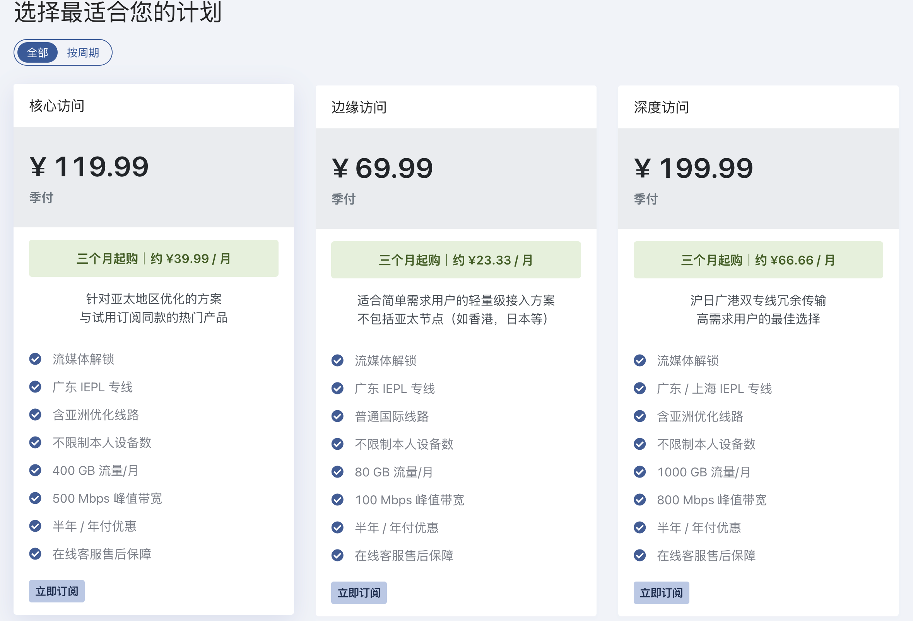

写在前面

## 免责声明与使用须知

### 传播限制
- 严禁在境内社交平台（微信/微博/贴吧等）转发本分享内容
- 本文档禁止作为商业推广素材使用

### 合规指引
1. **核心用途建议**
    ▫️ 学习

    ▫️ 观影

2. **风险规避**
    - 网络言论审查就在身边，管住嘴，保持清醒的头脑
    - 尽量不去看一些降智网站，频道

### **行业风险警示**
- **运营不确定性**
    ▫️ 机场主卷钱跑路

    ▫️ 机场因风险/资金链断裂被迫终止服务

- **隐私保护**
   注册建议使用国外邮箱（如Gmail，outlook）

### 充值建议
- 新用户建议月付多试用几个机场
- 不建议使用白嫖节点，VPN或机场（不安全）

### 法律声明
本博客仅提供网络传输性能分析报告，实际效果可能因网络环境而异，禁止用于违法用途，用户行为后果需自行承担

# BitzNet
> 官网直达
> [BitzNet](https://af2.bnaffloop.com/#/register?code=edKO35ar)

---

<aside class="notion-callout">
📢

💬老板是美国人，和奶昔用的是同一个上海机房，日本和美国线路是走的沪日,稳定高速，全能战士，开局先送5个G可以去试用下

</aside>

## 一、基础档案

### 1.1 运营概况
- **开业时间：**
- **类别：**专线
- **协议支持：**Trojan
- **线路：**#深港专线 #沪日专线

### 1.2 优势
- ✅ 带宽大
- ✅ 用户多
- ✅ 开业时间长

---

## 二、服务方案

### 2.1 套餐矩阵

---

## 三、支付
**支持渠道**：

- 支付宝+微信+信用卡+USDT

> 官网直达
> [WestData](https://wd-gold.com/aff.php?aff=9608)
